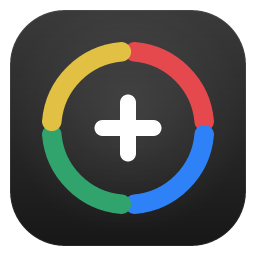
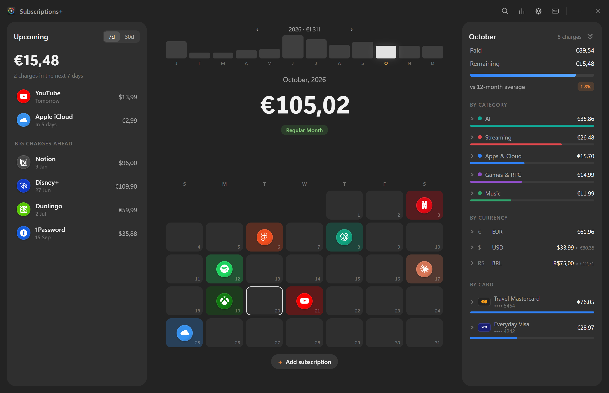
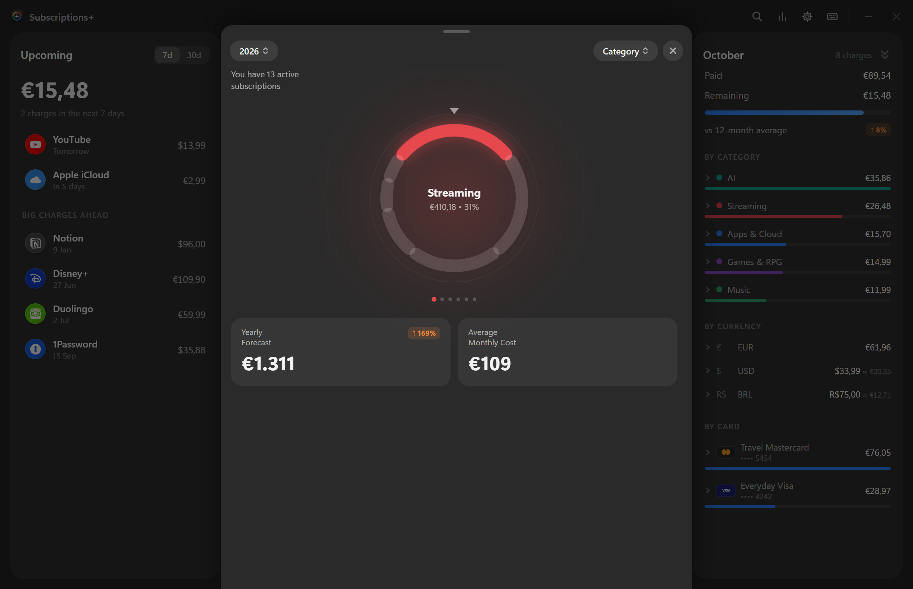
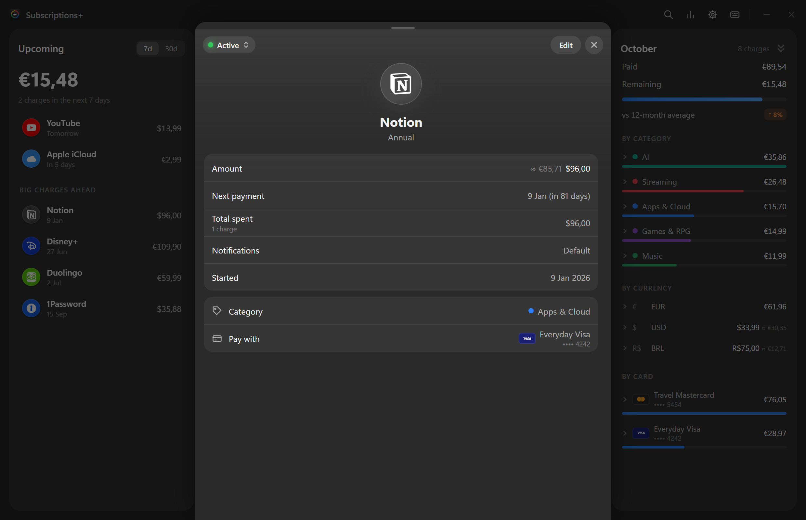
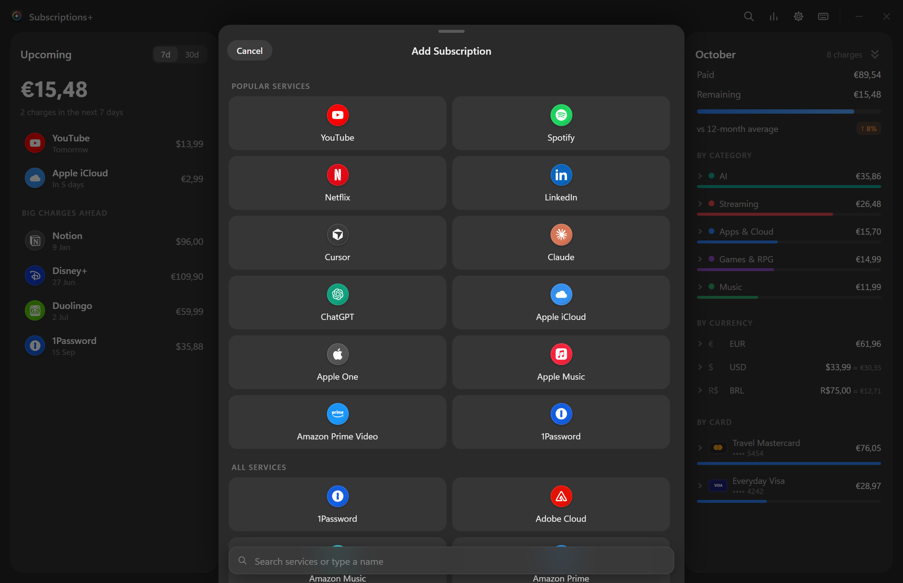
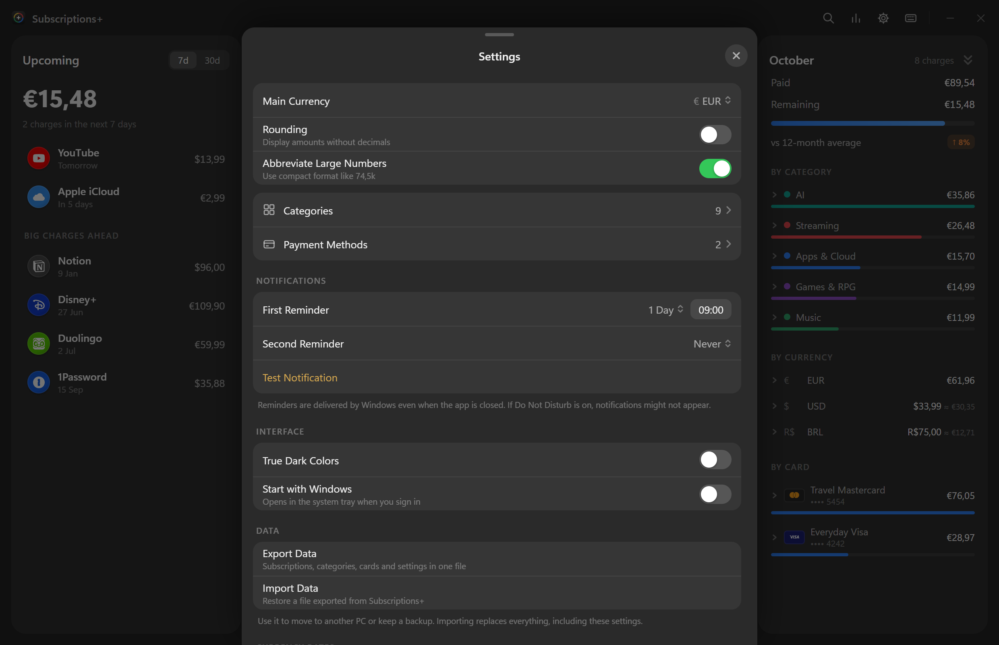
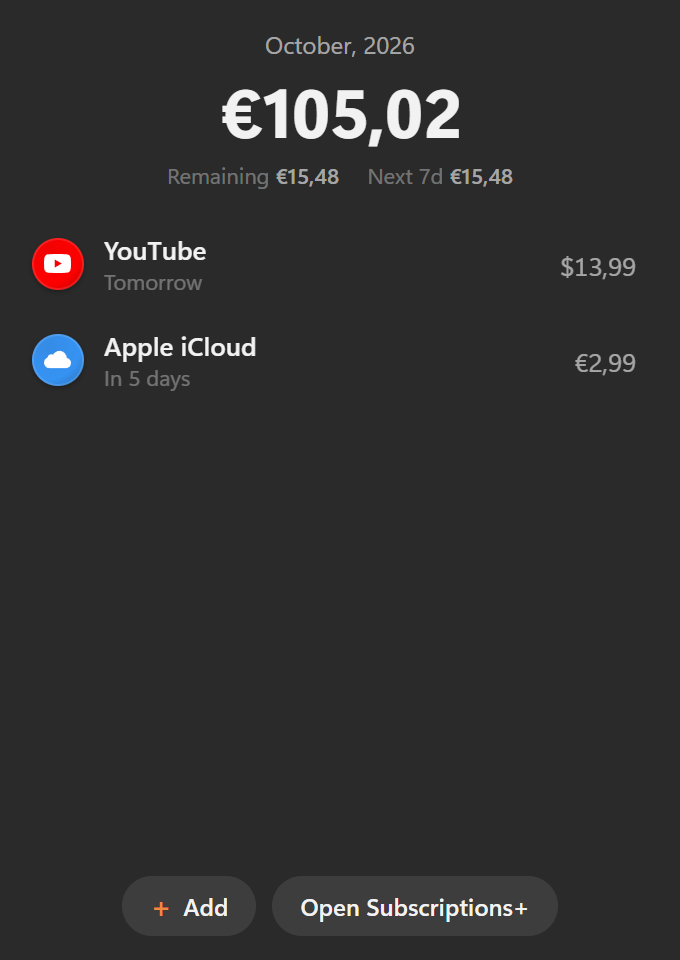

<p align="center"></p>

<h1 align="center">Subscriptions+</h1>

<p align="center">A native Windows app to keep track of your subscriptions: what you pay, when you pay it and how it adds up.</p>



Subscriptions+ is a small desktop app for Windows 10/11. Everything stays on your PC in one JSON file next to the executable: no account, no cloud, no telemetry.

## Features

- **Calendar of charges.** Each day shows the icons of what is charged, with the month total, a 12-month bar strip and a badge that points out the big annual charge of the month. Scroll the mouse wheel or press ← → to change month.
- **Three panels.** *Upcoming* (next 7 or 30 days and big annual charges ahead), the calendar, and the *month breakdown*: paid vs. remaining, comparison with the 12-month average, and totals by category, by currency and by card. Each group opens to show its subscriptions (several can be open at once, with expand/collapse all).
- **Real price history.** Price changes, earlier plans, pauses and resumes are kept, so past months show what you actually paid and future months show the current price.
- **Any billing cycle.** Monthly, yearly, every N days/weeks/months/years, one-time payments and free trials, with end dates, cancellation and archive.
- **Three currencies.** EUR, USD and BRL, each subscription in its own currency, converted to your main currency with European Central Bank rates (updated automatically).
- **Payment methods.** Name, brand and only the last four digits of each card.
- **Statistics.** Yearly forecast, average monthly cost, change vs. the previous year, a month-by-month chart and a ring chart by category.
- **Windows reminders.** Up to two native notifications before each charge, delivered by Windows even when the app is closed.
- **Tray.** Lives in the system tray, with a mini-window showing the month total and the next charges. It can start with Windows.
- **Icons.** About 80 popular services built in, plus an online icon search (Iconify) for anything else; picked icons are saved in the data, so they work offline.
- **Keyboard first.** `N` add, `F` search, `S` statistics, `T` today, `Ctrl+,` settings, `?` all shortcuts.
- **Export and import.** One file with all subscriptions, categories, cards and settings, to move to another PC or keep a backup.

| Statistics | Subscription details |
|---|---|
|  |  |

| Add a subscription | Settings | Tray mini-window |
|---|---|---|
|  |  |  |

*Screenshots use fictional demo data ([scripts/demo-data.mjs](scripts/demo-data.mjs)).*

## Install

1. Download `Subscriptions+.exe` from the [latest release](../../releases/latest) (or [build it](#build-from-source)).
2. Put it in a folder of your choice, for example `Documents\Subscriptions+`, and run it. Windows SmartScreen may warn about an unsigned app: choose *More info → Run anyway*.
3. The app creates a `data` folder next to the executable. That folder is everything: copy it to back up, delete it to start over.

It needs the Microsoft Edge WebView2 runtime, which is already part of Windows 10 and 11.

### Moving your data

- **Export:** Settings → Data → *Export Data* saves `subscriptions-plus-YYYY-MM-DD.json`.
- **Import:** on the new PC, Settings → Data → *Import Data*, pick the file and confirm. Importing **replaces** everything (subscriptions, categories, cards and settings, including *Start with Windows*).

To try the app with the demo data: `node scripts/demo-data.mjs demo.json`, then import `demo.json`.

## Build from source

Requirements: [Node.js](https://nodejs.org/) 22+, [Rust](https://rustup.rs/) (stable, MSVC toolchain) and the Visual Studio C++ Build Tools.

```bash
npm install
npm test                 # unit tests (Vitest)
npm run tauri build      # release build
```

The executable is created at `src-tauri/target/release/subscriptions-plus.exe`; copy it wherever you like (for example as `Subscriptions+.exe`). During development, `npm run tauri dev` runs the app with hot reload, and `npm run dev` runs only the interface in a browser (data then lives in the browser's localStorage).

`node scripts/screenshots.mjs` regenerates the images in `docs/` from the demo data with headless Microsoft Edge.

## How it works

| Part | Technology |
|---|---|
| Window, tray, files, notifications | [Tauri 2](https://tauri.app/) (Rust) with WebView2 |
| Interface | React 19 + TypeScript, built with Vite |
| Animations | [Motion](https://motion.dev/) springs and [NumberFlow](https://number-flow.barvian.me/) for animated numbers |
| Icons | [Simple Icons](https://simpleicons.org/) and [Iconify](https://iconify.design/) glyphs bundled at build time (`scripts/build-glyphs.mjs`) |
| Notifications | WinRT `ScheduledToastNotification` through the `windows` crate |
| Exchange rates | [Frankfurter](https://frankfurter.dev/) (European Central Bank) |

Charges are never stored: they are computed from each subscription's rules (start date, cycle, price history and earlier plans), so editing a subscription updates the whole calendar, past and future. The core logic lives in `src/lib` (`schedule.ts`, `history.ts`, `stats.ts`, `upcoming.ts`) and is covered by tests.

**Network use:** only the daily exchange-rate request and, when you use the online icon search, requests to the Iconify API. Nothing else leaves your PC.

```
src/                 React interface
  components/        calendar, panels, forms, settings, statistics
  lib/               data model, schedule and statistics logic, tests
src-tauri/           Rust side: storage, tray, dialogs, notifications, autostart
scripts/             glyph bundler, demo data, screenshots
docs/                README screenshots
```

## License

[MIT](LICENSE): free to use, modify and share, keeping the copyright notice.
